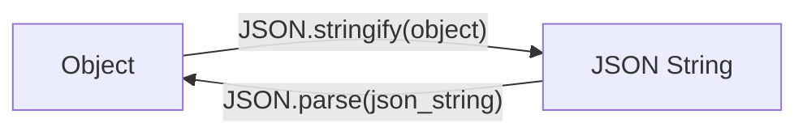

# JSON

::left:: 

JSON (JavaScript Object Notation) is a lightweight, text-based data format used to **store and exchange structured data.**

### Key Features

- Human-readable 
- Language-independent 
- Simple & Lightweight 
- Widely adopted 

::right::

###### Example

```json
{
  "name": "Bagus",
  "is_active": true,
  "age": 21,
  "tech_stacks": ["TypeScript", "King PHP"],
  "major": {
    "name": "Informatika",
    "year": 2023
  }
}
```

---
hideInToc: true
---

# Structure and Syntax

#### Main Components

- **Object:** A collection of key-value pairs enclosed in `{}`.
- **Array:** An ordered list of values enclosed in `[]`.
- **Data types:** Strings, numbers, booleans, null, objects, and arrays.

<br>

###### Example

```json
{
  "name": "Bagus",
  "is_active": true,
  "age": 21,
  "tech_stacks": ["TypeScript", "King PHP"],
  "major": {
    "name": "Informatika",
    "year": 2023
  }
}
```

---
layout: two-cols-header
hideInToc: true
---

# Uses, Advantages, and Limitations

### Common Uses

- Exchanging data between applications
- Sending and receiving data through web APIs
- Storing application configuration
- Representing structured information

<br>

::left::

### Advantages

- Simple and readable syntax
- Easy integration with many languages
- Supports nested and flexible data structures

::right::
### Limitations

- Does not support comments in standard JSON
- Requires strict syntax
- Can be less efficient than specialized formats for certain workloads

---
hideInToc: true
---

# Serialization and Deserialization

### Serialization

Converts an in-memory data structure into a format suitable for storage or transmission.

### Deserialization

Converts serialized data back into a usable data structure.

In JavaScript/TypeScript, JSON serialization and deserialization commonly use:

- `JSON.stringify()`, object -> JSON string.
- `JSON.parse()`, JSON string -> object.

<br>



---
hideInToc: true
---

# Serialization in TypeScript

Serialization converts an object into a JSON string.

```ts
interface Student {
  name: string;
  age: number;
  isStudent: boolean;
}

const student: Student = {
  name: "Alice",
  age: 21,
  isStudent: true,
};

const jsonString = JSON.stringify(student);

console.log(jsonString);
console.log(typeof jsonString);
```

### Output

```
{"name":"Alice","age":21,"isStudent":true}
string
```

---
hideInToc: true
---

# Deserialization in TypeScript

Deserialization converts a JSON string back into a JavaScript value.

```ts
interface Student {
  name: string;
  age: number;
  isStudent: boolean;
}

const jsonString =
  '{"name":"Alice","age":21,"isStudent":true}';

const student: Student = JSON.parse(jsonString);

console.log(student.name);
console.log(student.age);
```

### Output

```text
Alice
21
```

---
layout: two-cols-header
hideInToc: true
---

# Serialization and Deserialization in Practice

::left::

### Common Applications

- **Web APIs:** Exchange data between frontend and backend.
- **Local storage:** Save application data in the browser.
- **Configuration:** Load settings from JSON files.
- **Data transfer:** Send structured data between systems.

::right::

###### Example: Browser Local Storage

```ts
const websiteConfig = {
    theme: "default",
    isDark: true,
};

// Serialize and save
localStorage.setItem(
  "websiteConfig",
  JSON.stringify(websiteConfig)
);

// Retrieve and deserialize
const storedData = localStorage.getItem("websiteConfig");

if (storedData !== null) {
  const parsedData: unknown = JSON.parse(storedData);
  console.log(parsedData);
}
```

---